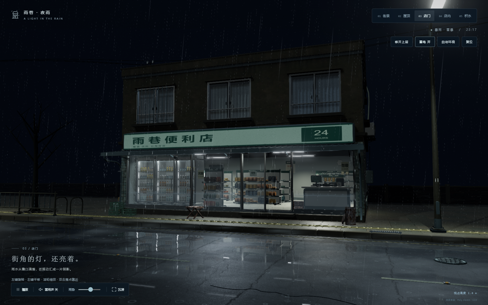
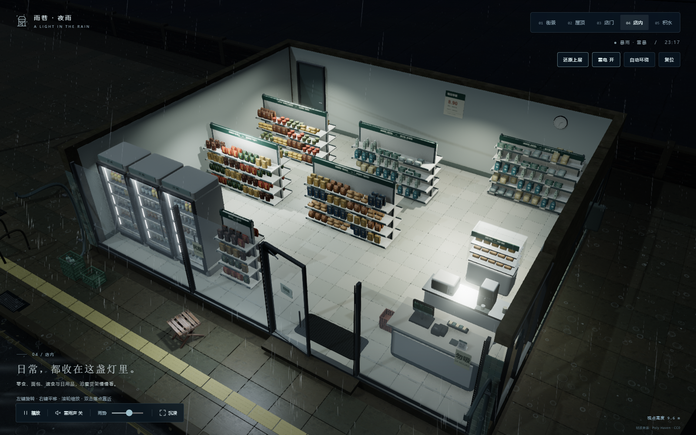

# 雨巷便利店 · 暴雨街景

一个可以旋转、平移和缩放的 Three.js 三维夜景网页：深夜便利店、冷色路灯、暴雨、积水倒影、闪电与延迟雷声。场景没有人物。



## 直接体验

仓库已经包含构建好的 `index.html`、`app.js` 和 `assets/`，上传后可直接作为静态网站发布。

本地预览需要 Node.js 20 或更新版本。在项目文件夹内运行：

```powershell
npm start
```

然后访问 `http://127.0.0.1:3000`。Windows 也可以双击 `preview.cmd`，根据窗口提示打开浏览器。仅预览已构建的网站不需要先安装 npm 依赖。

网站版需要通过本地服务器或网站地址访问。若要直接双击 HTML 使用，生成下面的离线版。

## 从源码构建

```powershell
npm ci
npm run build
```

构建会更新根目录的 `index.html` 和 `app.js`。修改后上传这两个文件以及改动过的源码、资源；不需要上传 `node_modules/`。

生成包含所有资源的单文件离线版：

```powershell
npm run build:offline
```

输出为 `dist/rainy-corner.html`，可以双击打开。这个大文件不纳入 Git；GitHub Pages 使用根目录的分文件网站。

## 操作

| 操作 | 效果 |
| --- | --- |
| 鼠标左键拖动 / 单指拖动 | 旋转视角 |
| 鼠标右键拖动 | 平移视点 |
| 滚轮 / 双指缩放 | 拉近、拉远 |
| 双击地面 | 靠近该位置 |
| 街景、屋顶、店门、店内、积水 | 切换预设镜头 |
| 移开上层 | 查看店内剖视，隐藏上层和雨棚招牌 |
| 雨势、雷电、雷雨声 | 调节天气和声音；声音需要点击开启 |
| 暂停、自动环绕、沉浸 | 控制动画和界面 |
| 数字 1–5 / R / Esc | 切换视角 / 返回全貌 / 退出沉浸 |

默认启用实时高画质，包括材质纹理、软阴影、环境遮蔽和动态积水反射。设备负载高时会自适应调整渲染分辨率。

## 场景内容

- 一栋完整便利店，上层窗户、窗帘、屋顶设备、雨棚和排水管。
- 饮料冰柜，以及零食、饼干、方便面、粮油、面包、早餐、纸品和洗护商品。
- 商品包装、价签、购物篮、面包柜、收银台、小票机、微波炉和咖啡机。
- 六盏路灯模型、双向街道、斑马线、盲道、排水口、井盖、护栏和街树。
- 暴雨、水花、屋檐流水、积水倒影、闪电与延迟雷声。



## 目录

```text
rainy-convenience-store/
├─ index.html                 # 已构建的网站入口
├─ app.js                     # 已构建的浏览器程序
├─ assets/                    # 材质、环境光和模型；网站运行必需
│  ├─ textures/
│  ├─ environment/
│  ├─ models/
│  └─ sources.json            # 资源来源记录
├─ src/
│  ├─ scene.js                # 可直接编辑的场景源码
│  ├─ page.html               # 界面与样式模板
│  ├─ assets.js               # 材质路径
│  ├─ night.js                # 环境光资源路径
│  └─ models.js               # 模型路径
├─ scripts/                   # 构建与本地预览
├─ tests/                     # 浏览器验收脚本
├─ docs/
│  ├─ GITHUB_UPLOAD.md        # 中文上传和发布教程
│  ├─ DEVELOPMENT.md          # 继续开发说明
│  ├─ VALIDATION.md           # 整理后的验证结果
│  └─ images/                 # 项目截图
├─ licenses/                  # 第三方许可文本
├─ THIRD_PARTY_NOTICES.md
├─ package.json
├─ package-lock.json
├─ preview.cmd
├─ .gitignore
└─ .nojekyll
```

`node_modules/`、`dist/` 和 `reports/` 是本地生成目录，已在 `.gitignore` 中排除。项目不依赖原始工作区、Python、Blender 或任何 API 密钥。

## 上传 GitHub 和发布网页

请按 [中文上传教程](docs/GITHUB_UPLOAD.md) 操作。分文件网站使用相对资源路径，可发布到仓库对应的 GitHub Pages 子目录。

## 验证

```powershell
npm ci
npm run build
npm run build:offline
npm test
npm run test:ui
npm run test:storm
npm run test:render
```

Windows 测试脚本优先使用已安装的 Edge 或 Chrome。其他环境请先执行 `npx playwright install chromium`，也可以用环境变量 `BROWSER_EXECUTABLE` 指定浏览器。`test:render` 包含帧率检查，结果依赖设备性能；截图与测试报告保存在 `reports/`。

资源和库的来源见 [第三方资源说明](THIRD_PARTY_NOTICES.md)。
